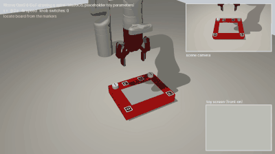
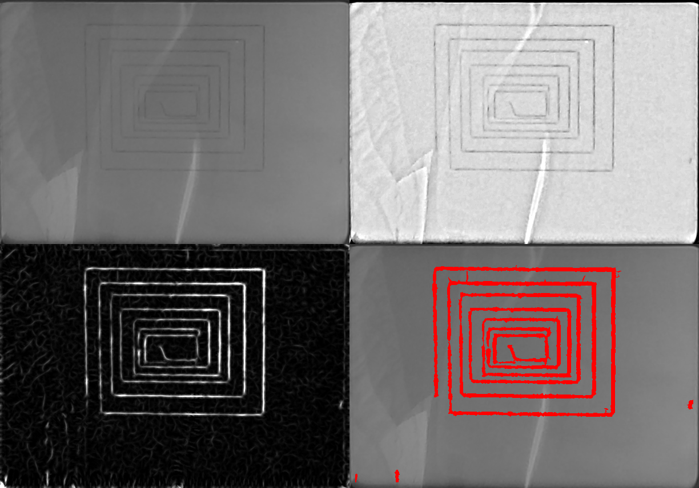

# Etch-a-Sketch robot artist

A Kinova Gen3 arm (6-DoF, Robotiq 2F-85 gripper) draws on a classic Etch A Sketch by turning its knobs one at a
time, watched by a scene camera (Intel RealSense D435) and the arm's wrist camera. An LLM agent will plan the
drawings and correct them from what the camera sees.

This repository holds the simulation and the code that runs unchanged on the real arm. Everything is written
against one skill interface (`src/etch_sim/interface.py`) with three backends:

| Backend | Status | Use |
|---|---|---|
| Toy kernel (`kernel.py`, `kernel_backend.py`) | done | planner and agent tests in milliseconds, with fault injection |
| MuJoCo (`src/etch_sim/mj/`) | done, except erase | grasping, reach, cameras, timing |
| Real arm (`src/etch_sim/real/`) | built; tested only against a simulated arm server | hardware |

## Simulation

The arm grasps a knob, turns it, releases, switches to the other knob, and the scene camera measures the line:



## Sketch extraction from the real camera

The scene camera sees a faint grey line on a reflective grey screen. `sketch_extract.py` finds it through glare
and uneven light. Panels: front-on screen, lighting flattened, line strength, detected line (red):



How it works: rectify the screen from its four corners, take the median of a 10-frame burst, keep only pixels
darker than the screen on *both* sides of a short line segment (so glare edges do not count), divide by local
brightness, mark saturated glare as unknown, then threshold with hysteresis and drop short, weak pieces.
Thresholds are tuned on two hand-drawn captures so far.

## Install

```bash
uv sync
uv run pytest -q
```

Python 3.12, dependencies in `pyproject.toml`. MuJoCo renders offscreen; no GPU needed.

## Run

Simulation (writes to `out/`, which git ignores):

```bash
uv run python scripts/s0_demo.py      # toy kernel: calibrate, erase, draw
uv run python scripts/s1_demo.py      # MuJoCo scene: cameras, markers, live screen
uv run python scripts/s2_demo.py      # arm turns the knobs, camera calibration, open-loop square (~30 s)
uv run python scripts/s3_demo.py      # image -> route planner, drawn on the toy kernel; --image my.png --budget 600
uv run python scripts/make_video.py   # video of the arm drawing; --shape square|staircase|spiral (~90 s)
uv run python scripts/fit_hand_measurements.py hardware/x_sweep.csv   # fit mm/deg and backlash from hand data
```

Real scene camera (Intel RealSense D435; read-only, no arm). Captures and results go to `test_images/`,
which git ignores. **Use a Linux laptop for the camera.** On macOS librealsense can only open the D435 after
killing macOS's camera services (with `sudo`), and that froze the whole Mac three times; `rs_capture.sh`
therefore refuses to run on macOS. Everything else (sim, tests, `--replay`) runs on any OS.

One-time setup on the Linux laptop:

```bash
git clone -b dev https://github.com/raoulbouri/etch-a-sketch.git && cd etch-a-sketch
uv sync --group realsense                 # adds pyrealsense2 (Linux wheels, Python 3.12)
uv run pytest -q                          # everything should pass
```

MuJoCo renders offscreen; on a Linux machine without a display, set `MUJOCO_GL=egl` (or `osmesa`) for the sim tests.

If the camera is not found or access is denied, install Intel's udev rules
([99-realsense-libusb.rules](https://github.com/IntelRealSense/librealsense/blob/master/config/99-realsense-libusb.rules)
into `/etc/udev/rules.d/`, then `sudo udevadm control --reload-rules && sudo udevadm trigger`) and replug.

Camera commands:

```bash
sh scripts/rs_capture.sh grab                    # one-off: 10 colour frames -> test_images/rs/<time>/
uv run python scripts/analyze_sketch.py --pick   # newest capture: click the 4 screen corners (once per camera position)
uv run python scripts/analyze_sketch.py          # newest capture -> test_images/analysis/<capture>_rgb/panel.png
sh scripts/rs_capture.sh serve                   # camera server for a session: own terminal, leave running
sh scripts/rs_capture.sh --all                   # colour + aligned depth + infrared (not yet run on the camera)
```

Click the corners as seen from the knob side: bottom-left (nearest the left knob), bottom-right, top-right,
top-left. That order fixes the toy's orientation whichever way the camera sees it.

### Knob calibration by hand (mm per degree, backlash, knob directions)

Needs only a tape mark on each knob, so full turns can be counted. You turn rows of full turns, reversing
each row, with one turn of the other knob between rows; after every turn the camera takes a burst and the
new piece of line is measured.

1. Mount the D435 on its tripod looking at the screen. Do one `grab` and `analyze_sketch.py --pick` (above).
2. Terminal 1: `sh scripts/rs_capture.sh serve`, wait for `camera streaming`, leave it running.
3. Erase the screen. Put the pen about 1.5 cm in from the bottom-left corner (seen from the knob side).
4. Terminal 2: `uv run python scripts/hand_calibrate.py x --save`. It prints each turn; make it, press Enter.
5. Erase, back to the bottom-left start, then `uv run python scripts/hand_calibrate.py y --save`.
6. Ctrl-C the server. Results: `hardware/phase0_measurements.yaml`, and each session's captures and
   `fit.json` in `test_images/calib/<session>/` (re-measure later with `--replay <session>`).

Turn order. Left knob (`x`), 11 turns: left cw x3, right cw x1, left ccw x3, right cw x1, left cw x3.
Right knob (`y`), 11 turns: right cw x2, left cw, right ccw x2, left cw, right cw x2, left cw, right ccw x2.
("cw" = clockwise looking down at the knob; one turn = tape mark back to its start.)
The plan assumes clockwise moves the pen right (left knob) and up (right knob), true on Raoul's toy; for a
knob that goes the other way add `--flip x` or `--flip y`. If the first turn barely moves the pen, the script
says so: press `q`, erase, fix the start or the flip, rerun.

During each capture keep hands and shadows off the screen and do not bump the toy or tripod.
Expected accuracy (from simulated camera sessions): mm per degree to about 1%; backlash to about 5-8 deg,
because a hand turn rarely ends exactly on the mark. Precise backlash will come from the arm later.

Real arm: all motion goes through the motion server in the aims-kinova repo, inside a motion envelope that a
person approves when starting it. A refused or failed motion raises `ArmRefused`; nothing retries. Knob poses
are taught with `scripts/teach_pose.py` into `hardware/taught_poses.json`, or computed from two readings taken with the
gripper closed on each knob in Cartesian admittance: `uv run python scripts/knob_poses.py x.json y.json [--write]`.

## Code layout

| Module | What it does |
|---|---|
| `interface.py` | `Skills`: grasp a knob, rotate, release, observe the pen, photo, locate the board, erase |
| `kernel.py` | The toy: knob angle to stylus with backlash, end stops, string strain, strokes, erase |
| `kernel_backend.py` | Skills on the kernel, with slip, missed grasps, pen noise, timing; ground truth kept apart |
| `calibration.py`, `draw.py`, `scoring.py` | Back-and-forth calibration sweep and fit; open-loop drawer; chamfer score |
| `perception.py` | ArUco board localisation, rectification, line mask and pen tracking (simulation) |
| `sketch_extract.py` | Line extraction for real camera images |
| `planner.py` | Image to one continuous knob route: grid, joined pieces, retrace, straight-first Euler path, time budget |
| `turn_measure.py` | Full-turn calibration plan and fit; line-end helpers |
| `run_tracker.py` | Pen tracking over a whole run (real camera): ignores lines from before the run, lines that later disappear, and lines where the pen cannot be |
| `mj/` | 6-DoF Gen3 generated from Kinova's xacro, toy model, scene, IK, MuJoCo skills backend |
| `real/backend.py` | Client of the aims-kinova motion server |
| `real/knob_poses.py` | Knob approach/grasp poses from two hand-guided arm readings; safety, envelope and IK checks |

`hardware/` holds the measurement template, taught-pose template and the scene camera's screen corners.

## Placeholders

Toy and timing numbers are guesses until measured on the real toy: mm per knob degree, backlash, string snap,
the erase model, switch time and knob speed, toy dimensions, camera field of view and mounts. They are marked
`PLACEHOLDER` in the code; measurements go in `hardware/phase0_measurements.yaml`.

## Branches

`main` is the stable branch. Development happens on `dev`, and `scripts/promote_main.sh` brings `main` up to date.

## Vendored models

- `models/vendor/kinova_gen3_6dof`: xacro and meshes from Kinovarobotics/ros_kortex (noetic-devel, c3280d8), BSD-3-Clause.
- `models/vendor/robotiq_2f85`: google-deepmind/mujoco_menagerie (98a70c5), BSD-2-Clause.

Licences are kept beside the files. These files are not edited; changes go in the scene builder code.
